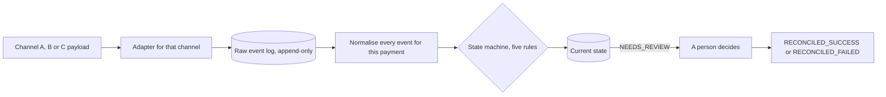
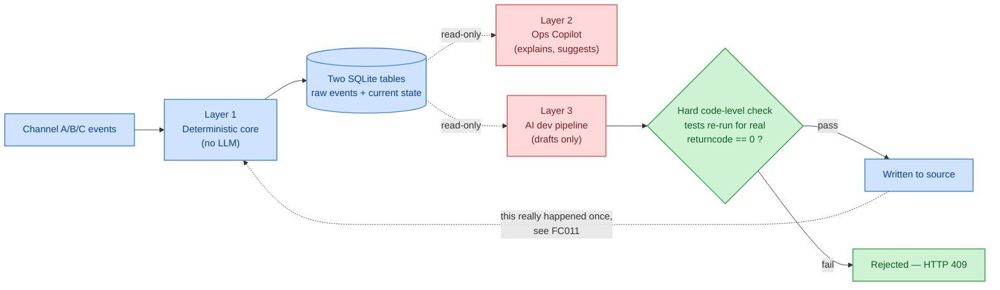

# Payment Reconciliation Engine

**English** · [简体中文](README.zh-CN.md)


Payment Reconciliation Engine takes the results of three simulated payment channels and turns them into one consistent, auditable payment status. Each channel uses its own field names and status codes, the same result can arrive twice, and one channel can return nothing at all. Conflicting and unrecognised signals go to a person instead of being guessed, and one success report is not enough to confirm a payment. It models the back office of a business that takes payments through several providers.

It is AI-assisted, and code sets the limits. A read-only assistant answers support staff's questions about a payment, and a four-agent pipeline drafts code changes to the engine. Neither can change a payment's final status. The core calls no model, the assistant's tools cannot write, and AI-drafted code reaches the source only after a person approves it and a code-level check re-runs the tests and gets exit code 0. The AI reviewer's opinion does not count in that check.

This is a personal engineering project. The payment channels are simulated and no real payment is processed. It is not a payment service and it is not production-ready. It started as a way to work through one real-shaped problem in depth, and to write down where an AI-assisted development workflow can be trusted and where it cannot.

This repository is a curated snapshot of a larger project: selected source for all three layers, a slice of the core's unit tests, the versioned assistant prompt, the [architecture](docs/ARCHITECTURE.md), an [engineering log](docs/ENGINEERING_LOG.md) of eleven real problems, the [design decisions](docs/DESIGN_DECISIONS.md), a poster and a film. The web front-end, the API layer, the evaluation harness with its raw data and the rest of the test suite are not included.

<table>
<tr>
<td><a href="https://zeeekrom.github.io/payment-reconciliation-engine/film/"></a></td>
<td><a href="docs/poster.jpg"></a></td>
</tr>
<tr>
<td align="center"><a href="https://zeeekrom.github.io/payment-reconciliation-engine/film/">Passed Everything, 3:57</a></td>
<td align="center"><a href="docs/poster.jpg">Poster: AI Agent Payment Lab, October 2026</a></td>
</tr>
</table>

**Film:** [watch *Passed Everything*, a 3:57 engineering investigation](https://zeeekrom.github.io/payment-reconciliation-engine/film/)
— recorded on a copy of this project on 13 November 2026, with real model calls: the AI reviewer approves a failing draft,
the code-level gate re-runs the tests and refuses it, and the timestamp bug from FC011 is put back and run again.
English narration (synthetic voice) with captions. The payment channels are simulated.

## Contents

- [At a glance](#at-a-glance)
- [The problem](#the-problem)
- [Who it is for](#who-it-is-for)
- [One payment, start to finish](#one-payment-start-to-finish)
- [Where the AI fits](#where-the-ai-fits)
- [What works today](#what-works-today)
- [Design principles](#design-principles)
- [How it was built](#how-it-was-built)
- [Problems that became rules](#problems-that-became-rules)
- [Technology stack](#technology-stack)
- [Verification evidence](#verification-evidence)
- [Try it](#try-it)
- [Security and data boundary](#security-and-data-boundary)
- [What is not finished](#what-is-not-finished)
- [What the project showed](#what-the-project-showed)
- [Copyright and licence](#copyright-and-licence)

## At a glance

| | |
|---|---|
| What it is | A payment reconciliation engine: three simulated channels in, one auditable status out, with two AI-assisted layers on top that can read and draft but not write payment state |
| Who it is for | The support, operations and engineering side of a business that takes payments through several providers. This public snapshot is for engineering reviewers |
| The problem | Providers report the same payment in different formats, at different times, sometimes twice and sometimes not at all. Matched wrongly, an order is marked paid when it was not |
| AI | A read-only support assistant (retrieval over four rule documents plus three read-only tools) and a four-agent pipeline (Planner, Developer, Tester, Reviewer) that drafts code behind human approval and a code-level test gate. Both call an OpenAI-compatible hosted API (Zhipu BigModel; defaults GLM-4-Flash and GLM-4-Plus). The core calls no model |
| Stack | Python, Pydantic, SQLite, httpx, python-dotenv and pytest. The full project adds a FastAPI layer and a web front-end, which are not in this snapshot |
| Evidence | 46 automated tests for the core, passing with no API key; an engineering log of 11 problems (FC001 to FC011), each with symptom, root cause, fix and category; 3 design decisions |
| Data | Simulated channel payloads only, with Chinese field names; Channel B uses WeChat Pay-style status codes. No real payment is processed |
| Status | A curated snapshot published on 11 Aug 2026, with a poster (Oct 2026) and a film (Nov 2026). A personal prototype, not a payment service |

## The problem

A business that takes payments through several providers has to settle each payment from reports it does not control. Before it can trust a status, it has to answer:

- Which field holds the order ID, and what does this provider's status string mean?
- Is this the same notification delivered again, or a new one?
- What happens when two channels disagree, or one sends a status nobody recognises?
- How many confirmations are enough before a payment counts as paid?
- What happens when a channel returns nothing at all?
- If an AI helps answer questions or write code, what stops it from changing a payment's status?

The engine answers these in deterministic code and keeps AI on the read-and-draft side of that line.

## Who it is for

| Role | The question they need answered | What the project shows them |
|---|---|---|
| Support or operations staff | What happened to this payment, and why is it in this state? | An assistant that looks up the record and its raw event history, cites its sources, and says when evidence is insufficient |
| Payments engineer | Can a new provider be added without touching the rules? | One adapter, one normaliser and one status-field entry per channel; the state machine never sees which channel an event came from |
| Reviewer or auditor | What did the channel actually say? | An append-only raw log kept apart from the current state, with the event IDs each state was derived from |
| Engineering lead using AI agents | Can AI-drafted code land without passing its tests? | A gate that re-runs the tests itself and refuses the write on any non-zero exit code, whatever the AI reviewer or a person said |

These roles describe who the design is for, not real users. The channels are simulated.

## One payment, start to finish



1. **A channel reports.** Channel A sends a full-sentence status and no event ID of its own. Channel B sends a notification ID and codes such as `SUCCESS`, `NOTPAY` and `REFUND`. Channel C may omit its response ID, or return nothing at all, which the pipeline reports as a timeout for that payment.
2. **The adapter packages it.** One adapter per channel copies the raw payload unchanged into a `RawChannelEvent` and stamps the UTC time it was received. Channel A always, and Channel C when its response ID is missing, get an event ID made from a SHA-256 hash of the content. Channel B must send its notification ID, or the event is rejected.
3. **The raw log keeps it.** The event goes into `raw_channel_events`, which is append-only. A repeated event ID is skipped with `INSERT OR IGNORE`, so a re-delivered notification is stored once.
4. **Every event is read again.** The pipeline re-reads the payment's full history, not only the new event, and normalises each one into `SUCCESS`, `FAILED`, `PENDING` or `UNKNOWN`. An unrecognised status becomes `UNKNOWN`; it does not crash the pipeline or count as a failure. `REFUND` is deliberately `UNKNOWN`, because refunds are out of scope.
5. **The state machine decides.** Five rules in priority order: success and failure together, or any `UNKNOWN`, go to `NEEDS_REVIEW`; failures only give `CHANNEL_FAILED`; two or more successes give `CHANNEL_CONFIRMED`; one success, only pending, or nothing yet stays `PENDING`.
6. **The current state is saved.** `payment_states` holds one row per payment, overwritten as evidence arrives, with the event IDs it was derived from.
7. **A person settles a review.** `resolve_manual_review()` turns `NEEDS_REVIEW` into `RECONCILED_SUCCESS` or `RECONCILED_FAILED` after a human decision and keeps the original event IDs. The Layer 3 agents wrote this function; see FC011.

## Where the AI fits



| Layer | What it does | What controls the result |
|---|---|---|
| Layer 1: deterministic core | Adapters, normalisation, state machine and storage | No model is called anywhere in the layer |
| Layer 2: Ops Copilot | Answers support staff's questions about a payment | Three read-only tools; answers only from tool results, with sources; "insufficient evidence" below a similarity of 0.3; at most five tool rounds, then a person |
| Layer 3: AI development pipeline | Planner, Developer, Tester and Reviewer draft code and tests into a scratch folder | The generated tests are really run; after a person approves, `apply_approved_changes()` runs them again and writes only on exit code 0 |
| Code Review Agent | Returns structured findings for a pasted piece of code | A separate tool; it returns findings and writes nothing |

The four agents cannot read files. Ordinary Python assembles their context, including the real source they must match, so the same input always sees the same context. Each agent must answer through a forced tool call with a fixed JSON shape.

Layer 1 calls no model, but not every line in it was written by hand. The event schema, adapters, normalisation and state rules were written by hand; the SQLite layer and the pipeline were written by AI and reviewed by a person; `resolve_manual_review()` came out of the Layer 3 pipeline. The full design is in [Architecture](docs/ARCHITECTURE.md).

## What works today

| Capability | Implemented |
|---|---|
| Channel adapters | Three adapters with different field names, status formats and ID rules; raw payload deep-copied and kept unchanged; UTC receive time |
| Duplicate handling | Event ID from the channel or a SHA-256 content hash; `INSERT OR IGNORE` on the event-ID primary key |
| Normalisation | One function per channel into four shared outcomes; unrecognised, empty and non-string statuses become `UNKNOWN` |
| State machine | Five priority-ordered rules checked against a decision table; two successes needed for `CHANNEL_CONFIRMED` |
| Manual review | `resolve_manual_review()` accepts only a `NEEDS_REVIEW` payment and one of two decisions |
| Storage | Two SQLite tables: append-only `raw_channel_events` and upserted `payment_states` |
| Routing | The pipeline is the only module that knows which channels exist; a new channel needs its own adapter and normaliser plus one row in each of three routing tables |
| Ops Copilot | Hosted embeddings with a hand-written cosine similarity (no vector database), three read-only tools, a tool loop capped at five rounds, strong tier by default, a versioned system prompt |
| AI development pipeline | Four agents with forced structured output; real reference source and real module path passed in; generated tests run with pytest; drafts kept out of project files |
| Write-back gate | Tests re-run before any write; any non-zero exit code raises `UnsafeToApplyError`, and the full project's API answers HTTP 409 |
| Code Review Agent | Findings with severity, category, summary and explanation, through a forced tool call |

## Design principles

- **An LLM never changes final payment state.** Each layer enforces this with a different mechanism.
- **Evidence and conclusions are kept apart.** The raw log is append-only. The current state can be revised as new events arrive.
- **Channel differences stop at the adapter.** The state machine never needs to know which channel an event came from.
- **Unknown is a signal, not an error.** An unrecognised status goes to review. It is not treated as a failure and does not crash the pipeline.
- **One confirmation is not enough.** A payment needs two independent successes before it is confirmed.
- **Look up exactly when you can.** A payment ID goes to SQL. Only open questions go to semantic search.
- **A rule in code beats a rule in a prompt.** The gate re-runs the tests itself instead of trusting a reviewer's explanation.
- **Keep it as simple as the scale allows.** No vector database for four documents, and a full recompute per event instead of incremental updates.
- **Fixed mistakes leave a trace.** The original line stays as a comment beside the fix, and the [design decisions](docs/DESIGN_DECISIONS.md) are append-only.

## How it was built

| Date | What changed |
|---|---|
| 8 Aug 2026 | Copilot system prompt v1. The Tester prompt gains two rules taken from real failures: check what setup already created, and import every module used |
| 10 Aug 2026 | FC011 found and fixed: an AI-written timestamp bug surfaced when the function was first wired to an endpoint |
| 11 Aug 2026 | Curated snapshot published, with the architecture, engineering log and design decisions |
| 11 Oct 2026 | One-page poster |
| 13 Nov 2026 | Film *Passed Everything* recorded on a copy of the project and published with a terms page |
| 14 Nov 2026 | Film re-encoded so it plays in more browsers |

The deterministic core was built and tested first. The AI layers were added on top, with read-only access to payment data.

## Problems that became rules

| What went wrong | What changed |
|---|---|
| The Developer and Tester agents invented module paths that did not exist | The real reference source and the real module path are passed into their prompts |
| The Developer and Tester stages kept failing, which looked like poor model reasoning; a 30-second timeout was cutting off long code generation (FC006) | Timeout raised to 90 seconds |
| Chinese text broke on Windows three times: in a curl request body, in terminal output, and in captured pytest output, which silently corrupted the result the Reviewer saw (FC002, FC003, FC007) | Payloads sent from UTF-8 files, `PYTHONIOENCODING=utf-8` for manual runs, and `encoding="utf-8"` on `subprocess.run()` |
| The AI made the same quote-nesting syntax error in two files in a row (FC005) | Both were fixed, and the rule is to parse every newly generated `.py` file with `ast.parse()` before trusting it |
| The Reviewer approved a draft with "7 passed, 6 errors", arguing that the errors were Windows cleanup issues. A stricter prompt had not stopped it (FC008) | `apply_approved_changes()` re-runs pytest and writes only on exit code 0 |
| In a real UI walkthrough a person clicked approve on "1 failed, 12 passed, 1 error"; the Tester had written a test that contradicted its own setup (FC010) | The gate refused the write with HTTP 409, and the Tester prompt now checks setup before writing a test |
| The evaluation script seeded one database while the tools read another, and marked two correct answers wrong (FC009) | Both point at the same database, and keyword checks accept the words the Copilot actually uses |
| The cheap tier called one tool and gave a shallow answer where the strong tier called all three (FC004) | The default became the strong tier; the missing answer-quality check is recorded as open |
| AI-written code passed its 6 AI-written tests, the gate and human review, then wrote local time instead of UTC, 10 hours apart in the logged case (FC011) | Fixed to UTC with the old line kept as a comment, a timezone assertion added, and the function wired to a real endpoint |
| An agent team was nearly given a task that did not touch the payment problem (D-003) | Before handing agents a sub-task, check that it connects to the real system; the team built the manual-review function instead |

Each entry has its symptom, root cause, fix and category in the [engineering log](docs/ENGINEERING_LOG.md). FC008 and FC011 are the two worth reading first.

## Technology stack

- Python with Pydantic models
- SQLite through the Python standard library
- httpx for a hand-written client to an OpenAI-compatible API (Zhipu BigModel: GLM chat models and the embedding-3 model)
- python-dotenv for configuration from environment variables
- Function calling with forced tool output for structured results
- Retrieval with a hand-written cosine similarity, no vector database and no numpy
- pytest
- FastAPI and a web front-end in the full project, not in this snapshot

## Verification evidence

- **46 automated tests pass** (`python -m pytest -q`, run on 16 Nov 2026 with Python 3.12): 17 for the channel adapters, 17 for status normalisation (12 test functions, one parametrised over six statuses) and 12 for the state machine. They need no API key and no network.
- **Who wrote them:** the core under test was written by hand and the tests were written with AI help, so the implementation and its tests did not come from the same model (the lesson from FC011).
- **What they do not cover:** this snapshot has no tests for the SQLite layer, the pipeline, `resolve_manual_review()`, the Copilot or the agents.
- **Two gate refusals are documented:** FC008 from scripted runs and FC010 from a real approval click in the UI.
- **One miss is documented:** FC011 got past the tests, the gate and human review. It is the only case in the log that got past every layer.
- **First-attempt success:** [Architecture](docs/ARCHITECTURE.md) reports that the AI development pipeline's pass@1 rose from roughly 40% to roughly 80% on the same five tasks over two rounds of prompt changes. The harness and its raw data are not in this snapshot, so that figure cannot be checked here.

The 46 tests check the core's logic on hand-written cases. They are not evidence about real payment providers.

## Try it

The core needs no external service or API key:

```bash
pip install -r requirements.txt
python -m pytest -q
```

Layers 2 and 3 call a hosted LLM API and need `BIGMODEL_API_KEY` set (see [`app/config.py`](app/config.py)). They have no runnable entrypoint in this snapshot, and the Copilot's rule documents (`data/docs/`) are not included. They are here to be read, not run end to end.

## Security and data boundary

- The payment channels are simulated. No real provider is connected and no real payment is processed.
- The API key is read from the environment, optionally from a `.env` file that git ignores. No key is in the repository.
- Layer 1 calls no model and no network. Its tests run offline.
- The Copilot's tools only read the database, and its prompt forbids claiming a status change. Its answers are returned as the model wrote them, with no automatic quality check (FC004).
- The gate proves that the generated tests pass, not that they test the right thing (FC011).
- Write-back appends the draft to the end of a local source file. There is no branch, pull request or CI step.
- This snapshot has no authentication or user roles. `resolve_manual_review()` takes a reviewer name but does not store it.
- Content-hash deduplication can drop a genuine second charge whose notification is byte-for-byte the same as the first (FC001).

## What is not finished

- An automatic check on Copilot answers: at least a rule that notices when a question names an order ID but no lookup was made, ideally with a second model pass as judge (FC004).
- An idempotency key created when a charge starts, so a real double charge can be told apart from a re-delivery (FC001). This belongs to starting payments, which is outside this project's scope.
- Refunds. `REFUND` goes to review as `UNKNOWN`, and the state machine has no refund states.
- A production write-back path: branch, commit, pull request, CI, human review, merge. Today it can only append; it cannot edit an existing function, remove duplicate imports or move test files. The one real merge done this way still needed a person to tidy the imports and move the test file.
- Incremental state updates. Each event recomputes the payment's full history, which would need to change if one payment had thousands of events.
- Recalibrating the retrieval threshold of 0.3 against more real questions.

## What the project showed

- "The tests passed" is a weaker claim than it sounds. Ask who wrote the tests and what they assert.
- A rule in a prompt is a request. A check in code is the guarantee.
- Check the measuring tool before blaming the model: a timeout, a decoding bug and a wrong database path all looked like AI failures at first.
- Code with no caller has not been validated. The FC011 bug surfaced only when the function was wired to a real endpoint.
- Keeping what went wrong on the record, including the bug that got past everything, makes the rest believable.

## Copyright and licence

© 2026 Payment Reconciliation Engine. All rights reserved; see [LICENSE](LICENSE). Without written permission, nothing in this repository may be copied, republished or adapted, and the project's code and design may not be rebuilt, whether by hand, with automated tools or with AI cloning tools. The code may not be reverse engineered except where the law allows, and the content may not be scraped, bulk-downloaded or used to train or evaluate AI models. Uses the law already allows, such as fair dealing for review or news reporting, are not affected. Sharing links is welcome. Versions published up to 16 November 2026 were released under the MIT License, and that licence still applies to them. The Python packages in `requirements.txt` are not included and keep their own licences. The film's third-party fonts, music and voice are listed on its [terms page](https://zeeekrom.github.io/payment-reconciliation-engine/film/terms.html). To ask for permission, contact me on [LinkedIn](https://www.linkedin.com/in/evan-h-165976301/).
