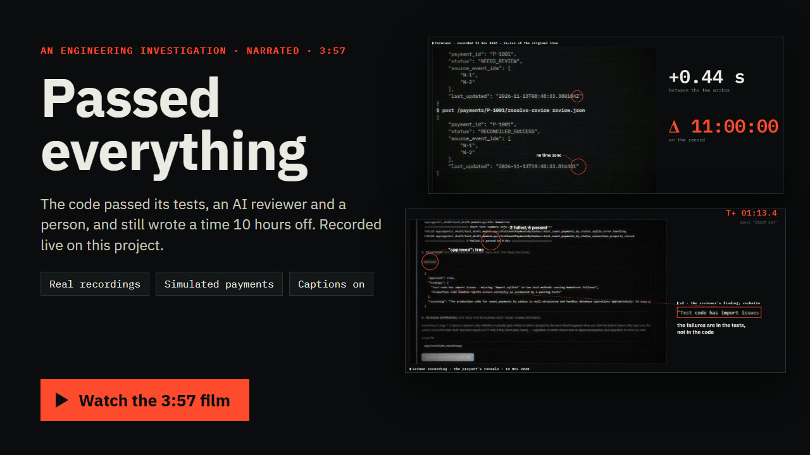
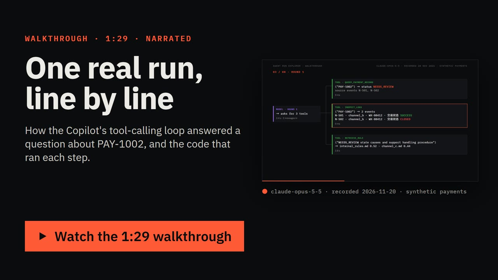
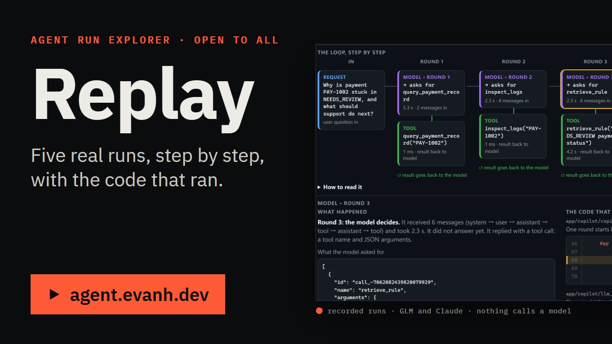
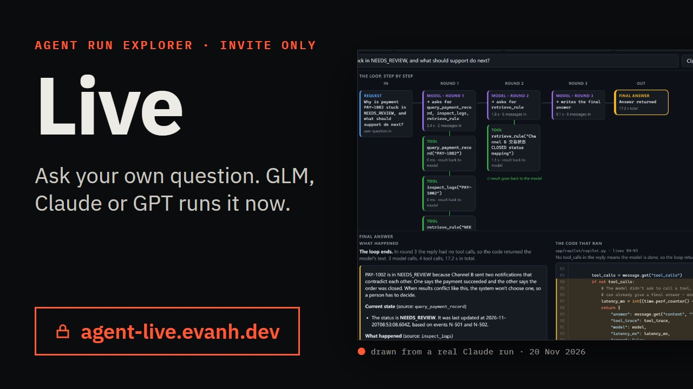

# Payment Reconciliation Engine

**English** · [简体中文](README.zh-CN.md)

Payment reconciliation for three simulated channels: deterministic code sets every status; AI only reads, explains and drafts.

<table>
<tr>
<td align="center" width="50%"> <b>Film</b> · 3:57</td>
<td align="center" width="50%"> <b>Walkthrough</b> · 1:29</td>
</tr>
<tr>
<td align="center" width="50%"> <b>Replay</b></td>
<td align="center" width="50%"> <b>Live</b> · invite only</td>
</tr>
</table>

**What you can check**

- **Only code sets a payment's status.** The core calls no model. When one payment gets both a success and a failure, it goes to a person instead of a guess. → [walkthrough](https://agent.evanh.dev/walkthrough/) · [state machine](app/core/state_machine.py)
- **The model names tools; the code runs them, five rounds at most.** Step through recorded runs, with the data each step handled and the code that ran. → [replay](https://agent.evanh.dev/) · [the loop](app/copilot/copilot.py)
- **It runs on real models.** Ask your own question; GLM, Claude or GPT drive the same loop and the same read-only tools. → [live, invite only](https://agent-live.evanh.dev/)
- **AI-drafted code must pass a check in code.** The tests are run again, and only a clean pass lets the code in; the AI reviewer's approval does not count. → [film](https://zeeekrom.github.io/payment-reconciliation-engine/film/)
- **An AI agent maintains this repository; a person merges.** Once a week it picks one small task and opens a draft pull request. The tests run on every pull request, and nothing merges without the owner. → [agent log](agent/LOG.md) · [test runs](https://github.com/Zeeekrom/payment-reconciliation-engine/actions/workflows/tests.yml)

Showcase snapshot: simulated payments, not a payment service; the full project is private. → [Status, source and terms](#status-source-and-terms)

## The problem

A business that takes payments through several providers has to settle each payment from reports it does not control:

- each provider uses its own field names and status codes;
- the same notification can arrive twice;
- two channels can disagree, or send a status nobody recognises;
- a channel can return nothing at all;
- and if an AI helps answer questions or write code, something has to stop it from changing a payment's status.

Matched wrongly, an order is marked paid when it was not.

## Who it is for

| Role | What the project shows them |
|---|---|
| Support or operations staff | What happened to a payment and why, from an assistant that looks up the record, cites its sources and says when the evidence is not enough |
| Payments engineer | A new provider is one more adapter, not a change to the rules |
| Reviewer or auditor | What each channel actually said, kept apart from the conclusion drawn from it |

These roles describe who the design is for, not real users. The channels are simulated.

## One payment, start to finish

1. **A channel reports.** Three simulated channels, each in its own format: one sends full sentences, one sends codes, one sometimes sends nothing.
2. **The report is kept as it arrived.** It goes into an append-only log; a re-delivered notification is stored once.
3. **Every report for the payment is read again** and translated into one of four shared outcomes. A status nobody recognises becomes "unknown", not a failure.
4. **Fixed rules decide.** Success and failure together, or anything unknown, go to review. One success is not enough: a payment needs two before it counts as confirmed.
5. **A person settles a review.** Only a person can mark a disputed payment as succeeded or failed, and the record keeps the reports it was based on.
6. **Support can ask why.** The assistant looks the payment up with read-only tools and explains its state, with sources. It cannot change it.

## How it is kept honest

- **No model in the core.** A payment's status comes from code that calls no model; the assistant's tools can only read.
- **Disagreement goes to a person.** Conflicting or unrecognised signals are never guessed.
- **Evidence and conclusion are kept apart.** The raw reports are never edited; the current status is derived from them and can be recomputed.
- **The assistant says when it doesn't know.** It answers only from what its tools returned, and when nothing relevant is found it says the evidence is insufficient.
- **A check in code beats a rule in a prompt.** AI-drafted code reaches the source only if the tests, run again by the code itself, pass.
- **Automated, with a person at the gate.** Once a week an AI agent works on this repository on a schedule. It may only open a draft pull request; a person decides what merges, and nothing reaches the main branch without a pull request whose tests pass.
- **The model can be swapped; the rules stay.** The same loop and the same read-only tools run on GLM, Claude or GPT, and the core reconciles payments with no model at all.
- **Security boundaries.** Live mode admits only invited people. Model keys stay on the server, never in this repository or the browser; deployments sign in with short-lived credentials instead of stored passwords; and every push to this repository is scanned for secrets.

## Problems that became rules

- **The persuasive reviewer.** An AI reviewer argued its way to approving a draft whose tests had not all passed. A stricter prompt did not stop it; re-running the tests in code did.
- **The bug that passed everything.** AI-written code passed its own AI-written tests, the check and a human review, and still logged local time instead of UTC. The same model had written the code and its tests.
- **The timeout that looked like a weak model.** Code generation kept failing. The cause was a 30-second timeout, not the model's reasoning.

## What it can and can't do today

- **Working:** three channel adapters, the rules and the review step; the read-only assistant on real models, with a replay and an invite-only live demo; automated tests on every pull request.
- **Not built:** refunds (they go to review); telling a genuine double charge from a re-delivered notification; an automatic check on the assistant's answers.
- **Not production:** simulated channels only, and no authentication or user roles. A personal prototype, not a payment service.

## Want the details?

The full source, a code tour on a call, the architecture, the design decisions, the engineering log of the eleven problems behind these rules (the code comments cite them as FC001–FC011 and D-001–D-003), the full test suite and the prompts aren't published here. Like the live demo, they're available on request — [message me on LinkedIn](https://www.linkedin.com/in/evan-h-165976301/) or email [yuxianghuang2026@gmail.com](mailto:yuxianghuang2026@gmail.com).

## Status, source and terms

A personal engineering project: the payment channels are simulated, no real payment is processed, and it is not a payment service or production-ready. This repository is a curated snapshot: the core, the assistant's loop and tools, part of the core's tests, a public outline of the assistant prompt, a film and the images above. The agent pipeline, the production prompts, the web front-end and the rest of the project are private.

© 2026 Payment Reconciliation Engine. All rights reserved; see [LICENSE](LICENSE). Without written permission, nothing in this repository may be copied, republished or adapted, and the project's code and design may not be rebuilt, whether by hand, with automated tools or with AI cloning tools. The code may not be reverse engineered except where the law allows, and the content may not be scraped, bulk-downloaded or used to train or evaluate AI models. Uses the law already allows, such as fair dealing for review or news reporting, are not affected. Sharing links is welcome. Versions published up to 16 November 2026 were released under the MIT License, and anyone who obtained them may keep using them under that licence. The repository's earlier history was removed in November 2026; copies made before then cannot be recalled. The Python packages in `requirements.txt` are not included and keep their own licences. The film's third-party fonts, music and voice are listed on its [terms page](https://zeeekrom.github.io/payment-reconciliation-engine/film/terms.html); the Agent Run Explorer and the walkthrough list theirs (voice, fonts, code highlighting) on [their terms page](https://agent.evanh.dev/terms.html). To ask for permission, contact me on [LinkedIn](https://www.linkedin.com/in/evan-h-165976301/) or by email at [yuxianghuang2026@gmail.com](mailto:yuxianghuang2026@gmail.com).
