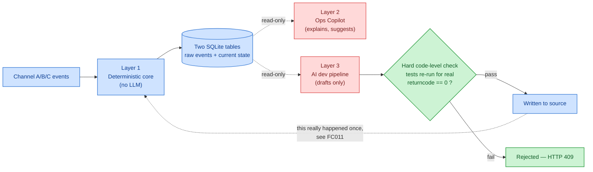
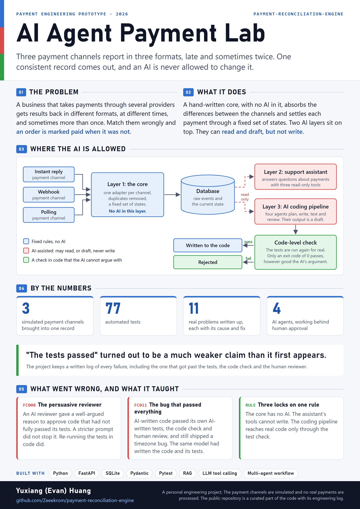

# Payment Reconciliation Engine

A personal engineering project: given raw results from three payment channels with genuinely different formats — different field names, different status-code conventions, one of them asynchronous and unreliable — reconcile them into one consistent, auditable payment status, with proper handling of conflicting, missing, or unrecognized signals.

Built in two deliberately separate phases:
- **A deterministic core** (Layer 1) — hand-written, zero AI involvement, fully covered by tests that need no API key to run.
- **An AI-assisted layer on top of it** (Layers 2–3) — a support Q&A assistant and a small AI development pipeline, both built with an explicit, code-enforced boundary: **an LLM is never allowed to directly change final payment state.**

This repo is a curated snapshot of that project — selected source files, the architecture writeup, and an honest log of real problems hit along the way (`docs/ENGINEERING_LOG.md`), not a sales pitch. Full context: [`docs/ARCHITECTURE.md`](docs/ARCHITECTURE.md) · [`docs/ENGINEERING_LOG.md`](docs/ENGINEERING_LOG.md) · [`docs/DESIGN_DECISIONS.md`](docs/DESIGN_DECISIONS.md).

---

## The core boundary



Three independent mechanisms enforce the same rule: Layer 1 has no LLM in it at all; Layer 2's tools have no write access; Layer 3's only path to real source code runs through a hard, code-level test check that an AI's opinion cannot override.

## What's worth reading first

- **[`docs/ARCHITECTURE.md`](docs/ARCHITECTURE.md)** — the full design: how the three channels' differences get absorbed before the state machine ever sees them, how the decision-table method surfaced a real gap in the reconciliation rules, and exactly what the AI-development write-back gate does and doesn't automate.
- **[`docs/ENGINEERING_LOG.md`](docs/ENGINEERING_LOG.md)** — eleven real problems hit during development, each with symptom → root cause → fix, honestly categorized as tooling issues, AI reasoning errors, or architectural gaps rather than lumped together. Two are worth reading on their own:
  - **FC008** — an AI reviewer gave a *reasoning-correct* justification for approving code that hadn't fully passed its tests. The fix wasn't a stricter prompt (already tried, still got argued around) — it was a hard, code-level re-check that doesn't care how convincing the AI's explanation is.
  - **FC011** — AI-generated code passed all 6 of its own AI-generated tests, passed the code-level gate, passed human review, and still shipped a timezone bug — because the same model wrote both the implementation and the tests that were supposed to catch it. The bug surfaced two days later, only once the code was actually wired into a real endpoint. This is the one case in the whole log that got past every layer of defense, and it's the reason the log includes what *didn't* work, not just what did.
- **[`docs/DESIGN_DECISIONS.md`](docs/DESIGN_DECISIONS.md)** — a short, append-only log of the tradeoffs behind the architecture, including a process rule that came out of catching a bad call before it shipped: *before handing an AI agent a sub-task, check that the task actually connects to the real problem — "this is standard practice" isn't sufficient justification on its own.*

## What's in this snapshot

This is a curated subset of a larger project, not the full application:

```
app/
  core/            Layer 1 — channel adapters, normalization, state machine, persistence
    channels/        one adapter per payment channel
  copilot/         Layer 2 — the read-only Q&A assistant (RAG + 3 tools)
  agents/          Layer 3 — the 4-agent development pipeline + the human-approval gate
prompts/           version-controlled system prompt for the Copilot
tests/             a representative slice of the Layer 1 test suite
docs/              architecture, engineering log, design decisions
```

Left out of this snapshot on purpose: the web front-end, the full evaluation harness and its raw run data, and the rest of the test suite — the goal here is a readable, self-contained core, not a full clone of the running app.

## Running it

Layer 1 is fully self-contained and needs no external service or API key:

```bash
pip install -r requirements.txt
pytest tests/
```

Layers 2 and 3 call a hosted, OpenAI-compatible LLM API and need `BIGMODEL_API_KEY` set (see `app/config.py`); they aren't wired into a runnable entrypoint in this snapshot — they're included to be read, not run end-to-end.

## Why this project exists

This started as a way to go deep on a specific, real-shaped problem — reconciling payment results from multiple unreliable, differently-formatted sources — and to be honest, in writing, about where an AI-assisted development workflow is trustworthy and where it isn't. The engineering log exists because "the tests passed" turned out to be a much weaker claim than it first appears, and that's worth having evidence for rather than just asserting.

## Poster



A one-page summary of the project, made in October 2026.

## License

MIT — see [`LICENSE`](LICENSE).
