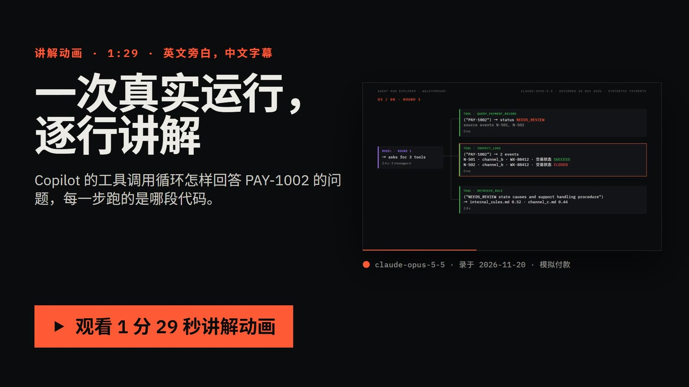
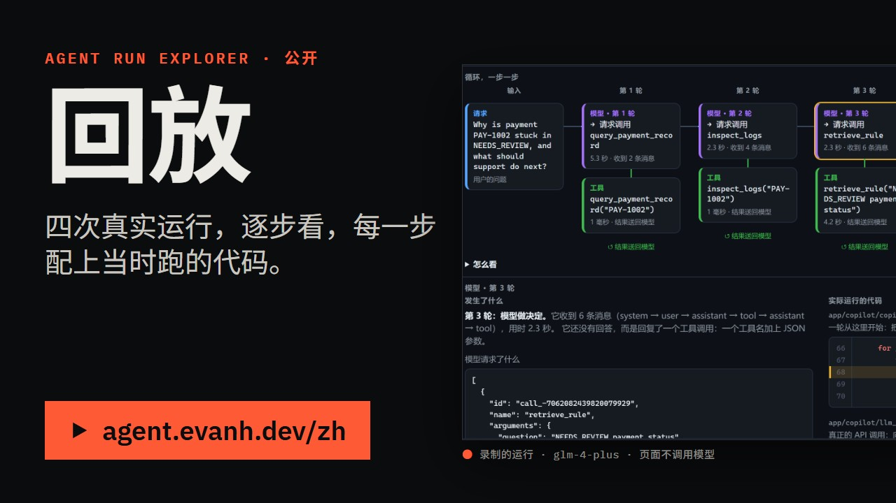
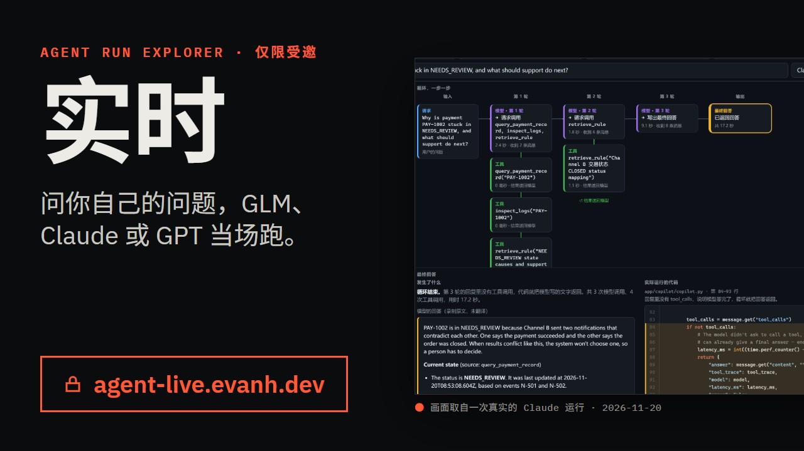

# Payment Reconciliation Engine

[English](README.md) · **简体中文**

三个模拟支付渠道的对账：每个支付状态都由确定性代码决定，AI 只读、只解释、只起草。

<table>
<tr>
<td align="center" width="50%"> <b>影片</b> · 3:57</td>
<td align="center" width="50%"> <b>讲解动画</b> · 1:29</td>
</tr>
<tr>
<td align="center" width="50%"> <b>回放</b></td>
<td align="center" width="50%"> <b>实时</b> · 仅限受邀</td>
</tr>
</table>

**能看到什么**

- **只有代码能定支付状态。** 核心层不调用模型。同一笔付款既有成功又有失败，就交给人判断，不去猜。→ [讲解动画](https://agent.evanh.dev/zh/walkthrough/) · [状态机](app/core/state_machine.py)
- **模型只点名工具，代码来跑，最多五轮。** 逐步看录下来的运行：每一步处理的数据，和当时跑到的代码。→ [回放](https://agent.evanh.dev/zh/) · [循环代码](app/copilot/copilot.py)
- **真的调模型。** 实时版可以自己提问，GLM、Claude 或 GPT 跑同一套循环和同样的只读工具。→ [实时版（仅限受邀）](https://agent-live.evanh.dev/live/zh/)
- **AI 起草的代码要过代码层面的检查。** 测试再跑一遍，全部通过才能写进源码；AI 审查员的批准不算数。→ [影片](https://zeeekrom.github.io/payment-reconciliation-engine/film/)
- **一个 AI 智能体在维护这个仓库，由人来合并。** 它每周挑一件小事，开一个草稿 PR。每个 PR 都自动跑测试，没有仓库主人点头，什么都合并不进来。→ [智能体日志](agent/LOG.md) · [测试记录](https://github.com/Zeeekrom/payment-reconciliation-engine/actions/workflows/tests.yml)

展示用的快照：付款是模拟的，不是支付服务；完整项目不公开。→ [状态、源码和条款](#状态源码和条款)

## 要解决的问题

一家通过好几个支付渠道收款的企业，要根据自己控制不了的报告来确认每一笔付款：

- 每个渠道的字段名和状态码都不一样；
- 同一条通知可能来两次；
- 两个渠道可能说法相反，或者发来没人认得的状态；
- 有的渠道干脆什么都不返回；
- 如果让 AI 帮忙答疑或写代码，还得有东西拦住它，不让它改付款状态。

对错了，没付钱的订单就会被标成已付。

## 给谁用

| 角色 | 这个项目给他们看什么 |
|---|---|
| 客服或运营 | 一笔付款发生了什么、为什么是这个状态：助手查记录、注明出处，证据不够就直说 |
| 支付工程师 | 接一个新渠道只是多写一个适配器，规则不用动 |
| 审核或审计 | 每个渠道原话说了什么，和据此得出的结论分开保存 |

这些角色说的是设计面向谁，不是真实用户。渠道都是模拟的。

## 一笔付款从头到尾

1. **渠道发来报告。** 三个模拟渠道，各有各的格式：一个发整句话，一个发状态码，一个有时什么都不发。
2. **报告按原样留存。** 写进只追加的日志；重复送达的通知只存一次。
3. **这笔付款的所有报告重读一遍**，翻译成四种统一结果之一。没人认得的状态记为“未知”，不算失败。
4. **固定规则来定。** 成功和失败同时出现，或者有任何“未知”，就转人工复核。一次成功不够，要两次才算确认。
5. **人来了结复核。** 有争议的付款只有人能定为成功或失败，记录里保留它依据的那些报告。
6. **客服可以问为什么。** 助手用只读工具查这笔付款，解释它为什么是这个状态，并注明出处。它改不了状态。

## 怎么保证靠谱

- **核心层没有模型。** 付款状态来自不调用模型的代码；助手的工具只能读。
- **说法冲突就交给人。** 冲突的、认不出的信号一律不猜。
- **证据和结论分开。** 原始报告从不修改；当前状态由它们推出来，随时可以重算。
- **助手不知道就说不知道。** 只根据工具查到的内容回答；查不到相关内容，就说证据不足。
- **代码里的检查胜过提示词里的规定。** AI 起草的代码，要代码自己把测试重跑一遍、全部通过，才能写进源码。
- **自动化，但闸门在人手里。** 每周有一个 AI 智能体按时来维护这个仓库：它只能开草稿 PR，并请另一家公司的 AI 来审；合并由人决定，没有测试通过的 PR，什么都进不了主分支。
- **模型能换，规矩不变。** 同一套循环和只读工具可以跑在 GLM、Claude 或 GPT 上；核心对账根本不用模型。
- **安全边界。** 实时版只放受邀的人。模型密钥只放在服务器上，不进仓库，也不发给浏览器；部署用短时效的凭证登录，不存账号密码；推到这个仓库的每次提交都会自动扫描密钥。

## 出过的问题怎样变成规则

- **会说服人的审查员。** AI 审查员讲出一番道理，批准了测试没全过的草稿。把提示词写得更严也没拦住；在代码里重跑测试才拦住。
- **什么都通过了的 bug。** AI 写的代码通过了 AI 自己写的测试、代码检查和人工审查，结果还是把本地时间当成 UTC 记了下来。代码和测试出自同一个模型。
- **看起来像模型变笨的超时。** 生成代码一再失败，原因是 30 秒的超时，不是模型推理不行。

## 现在能做什么、不能做什么

- **能做：** 三个渠道适配器、规则和人工复核；只读助手接真实模型，有回放版和仅限受邀的实时版；每个 PR 都自动跑测试。
- **没做：** 退款（一律转人工复核）；分辨真的重复扣款和重复送达的通知；自动检查助手的回答。
- **不能用于生产：** 只有模拟渠道，没有登录和用户角色。这是个人原型，不是支付服务。

## 想看更多？

完整源码、通话里的代码导览、架构说明、设计决策、记录这些规则背后十一个问题的工程日志（代码注释里引用的 FC001–FC011、D-001–D-003 就是它们）、完整的测试和提示词都不在这里公开。和实时版一样，可约看：[领英私信我](https://www.linkedin.com/in/evan-h-165976301/)，或发邮件到 [yuxianghuang2026@gmail.com](mailto:yuxianghuang2026@gmail.com)。

## 状态、源码和条款

这是一个个人工程项目：支付渠道是模拟的，不处理任何真实付款，不是支付服务，也不能用于生产。本仓库是精选快照：核心层、助手的循环和工具、核心层的一部分测试、助手提示词的公开摘要、一部影片和上面的图。智能体流水线、正式提示词、网页前端和项目的其余部分都不公开。

© 2026 Payment Reconciliation Engine，保留所有权利，见 [LICENSE](LICENSE)。未经书面许可，不得复制、转载或改编本仓库的任何内容，也不得用手工、自动化工具或 AI 克隆工具重建项目的代码和设计；除法律允许的情形外，不得对代码进行逆向工程；不得抓取、批量下载这些内容，或把它们用于训练、评测 AI 模型。法律本身允许的使用（如为评论、新闻报道合理引用）不受影响。欢迎分享链接。2026 年 11 月 16 日及以前发布的版本按 MIT 许可证发布，已经拿到这些版本的人仍可按 MIT 使用。仓库更早的历史记录已于 2026 年 11 月清除；在那之前被复制走的副本收不回。`requirements.txt` 里的 Python 包不在本仓库中，各自保留自己的许可。影片用到的第三方字体、音乐和语音列在它的[条款页](https://zeeekrom.github.io/payment-reconciliation-engine/film/terms.html)（英文）；Agent Run Explorer 和讲解动画用到的第三方部分（语音、字体、代码着色）列在它们的[条款页](https://agent.evanh.dev/zh/terms.html)。如需许可，请通过 [LinkedIn](https://www.linkedin.com/in/evan-h-165976301/) 或邮件 [yuxianghuang2026@gmail.com](mailto:yuxianghuang2026@gmail.com) 联系我。
