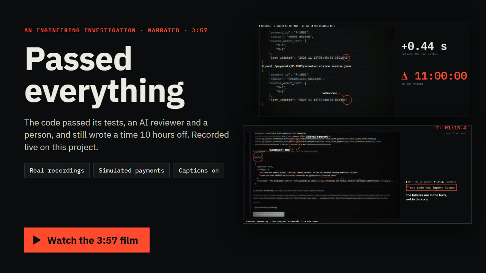
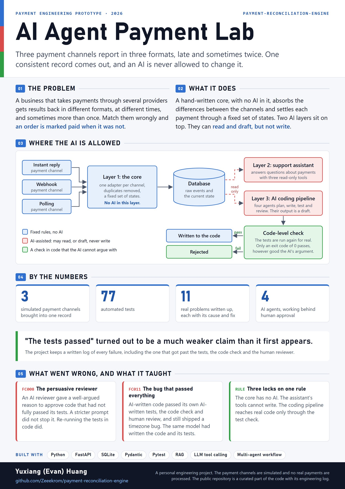
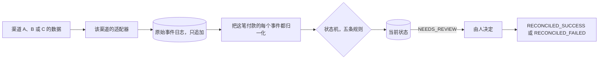
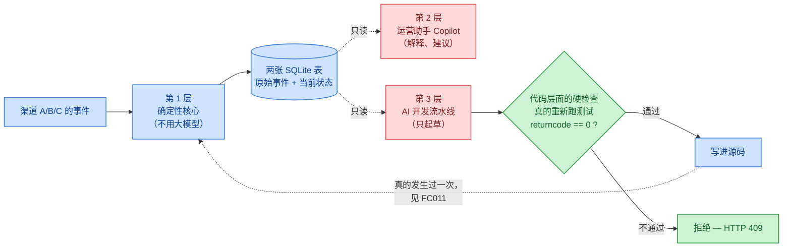

# Payment Reconciliation Engine

[English](README.md) · **简体中文**


Payment Reconciliation Engine（支付对账引擎）把三个模拟支付渠道返回的结果，合成一个前后一致、可以审计的支付状态。每个渠道的字段名和状态码都不一样，同一个结果可能来两次，其中一个渠道还可能什么都不返回。互相矛盾或认不出的信号会交给人处理，而不是去猜；只有一次成功报告，也不足以确认一笔付款。它模拟的是一家通过多个支付服务商收款的企业的后台。

它是 AI 辅助的，边界由代码来定。一个只读的助手回答客服人员关于某笔付款的问题，一条由四个智能体组成的流水线为引擎起草代码改动。两者都不能改变一笔付款的最终状态。核心层不调用任何模型，助手的工具不能写入，AI 起草的代码要先经人批准，再由代码层面的检查重新跑一遍测试、拿到退出码 0，才能写进源码。AI 审查员的意见在这道检查里不算数。

这是一个个人工程项目。支付渠道是模拟的，不处理任何真实付款。它不是支付服务，也不能用于生产。做它的初衷，是把一个贴近真实的问题彻底做透，并把 AI 辅助开发流程在哪里可信、在哪里不可信如实写下来。

这个仓库是一个更大项目的精选快照：三层各自挑选的源码、核心层的一部分单元测试、有版本的助手提示词、[架构说明](docs/ARCHITECTURE.md)、记录了十一个真实问题的[工程日志](docs/ENGINEERING_LOG.md)、[设计决策](docs/DESIGN_DECISIONS.md)、一张海报和一部影片。网页前端、API 层、评估工具及其原始数据，以及其余的测试都不在这里。

<table>
<tr>
<td><a href="https://zeeekrom.github.io/payment-reconciliation-engine/film/"></a></td>
<td><a href="docs/poster.jpg"></a></td>
</tr>
<tr>
<td align="center"><a href="https://zeeekrom.github.io/payment-reconciliation-engine/film/">Passed Everything，3 分 57 秒</a></td>
<td align="center"><a href="docs/poster.jpg">海报：AI Agent Payment Lab，2026 年 10 月</a></td>
</tr>
</table>

**影片：** [观看 *Passed Everything*，3 分 57 秒的工程调查片](https://zeeekrom.github.io/payment-reconciliation-engine/film/)
——2026 年 11 月 13 日在本项目的一份副本上录制，用的是真实的模型调用：AI 审查员批准了一份没通过测试的草稿，
代码层面的闸门重新跑测试并拒绝了它；FC011 里那个时间戳 bug 被放回去，再跑一遍。英文旁白（合成语音），带字幕。
支付渠道是模拟的。

## 目录

- [一眼看懂](#一眼看懂)
- [要解决的问题](#要解决的问题)
- [给谁用](#给谁用)
- [一笔付款从头到尾](#一笔付款从头到尾)
- [AI 用在哪里](#ai-用在哪里)
- [已经做到的](#已经做到的)
- [设计原则](#设计原则)
- [怎么一步步做出来的](#怎么一步步做出来的)
- [出过的问题怎样变成规则](#出过的问题怎样变成规则)
- [技术栈](#技术栈)
- [验证证据](#验证证据)
- [自己运行](#自己运行)
- [安全与数据边界](#安全与数据边界)
- [还没做完的](#还没做完的)
- [这个项目说明了什么](#这个项目说明了什么)
- [版权与许可](#版权与许可)

## 一眼看懂

| | |
|---|---|
| 是什么 | 一个支付对账引擎：三个模拟渠道进，一个可审计的状态出；上面有两层 AI 辅助，它们能读、能起草，但不能写支付状态 |
| 给谁用 | 通过多个服务商收款的企业里，负责客服、运营和工程的人。这个公开快照是给工程方面的审阅者看的 |
| 要解决的问题 | 不同服务商用不同格式、在不同时间报告同一笔付款，有时报两次，有时根本不报。匹配错了，没付的订单就会被标成已付 |
| AI | 一个只读的客服助手（在四份规则文档上做检索，加三个只读工具），以及一条四个智能体（Planner、Developer、Tester、Reviewer）的流水线，它起草的代码要经过人工批准和代码层面的测试闸门。两者都调用一个兼容 OpenAI 接口的托管 API（智谱 BigModel；默认 GLM-4-Flash 和 GLM-4-Plus）。核心层不调用任何模型 |
| 技术栈 | Python、Pydantic、SQLite、httpx、python-dotenv 和 pytest。完整项目还有 FastAPI 层和网页前端，不在这个快照里 |
| 证据 | 核心层 46 个自动化测试，不需要 API key 就能通过；一份记录 11 个问题（FC001 到 FC011）的工程日志，每条都写明现象、根因、修复和类别；3 条设计决策 |
| 数据 | 只有模拟的渠道数据，字段名是中文；渠道 B 用的是微信支付风格的状态码。不处理任何真实付款 |
| 状态 | 精选快照于 2026 年 8 月 11 日公开，之后加了海报（2026 年 10 月）和影片（2026 年 11 月）。个人原型，不是支付服务 |

## 要解决的问题

通过多个服务商收款的企业，得根据自己控制不了的报告来确定每笔付款的状态。在相信一个状态之前，它得答得上这些问题：

- 哪个字段是订单号？这家服务商的状态字符串是什么意思？
- 这是同一条通知又发了一次，还是一条新通知？
- 两个渠道说法不一致，或者某个渠道发来一个谁都不认识的状态，怎么办？
- 要几次确认，一笔付款才算真的付了？
- 渠道什么都不返回的时候怎么办？
- 如果用 AI 来回答问题或写代码，什么能阻止它改掉一笔付款的状态？

这个引擎用确定性的代码回答这些问题，并把 AI 留在“只读、只起草”的那一边。

## 给谁用

| 角色 | 他们需要回答的问题 | 这个项目给他们看什么 |
|---|---|---|
| 客服或运营人员 | 这笔付款发生了什么？为什么是现在这个状态？ | 一个助手：查出这条记录和它的原始事件历史，注明出处，证据不够时就直说 |
| 支付工程师 | 能不能不碰规则就接入一家新的服务商？ | 每个渠道一个适配器、一个归一化函数、一条状态字段登记；状态机从来不知道事件来自哪个渠道 |
| 复核人或审计人员 | 渠道当时到底说了什么？ | 只追加的原始日志，和当前状态分开存放，并记下每个状态是从哪些事件 ID 推出来的 |
| 使用 AI 智能体的工程负责人 | AI 起草的代码，能不能不通过测试就写进代码库？ | 一道闸门：自己重新跑测试，只要退出码不是 0 就拒绝写入，不管 AI 审查员或人怎么说 |

这些角色描述的是设计面向的人，不是真实用户。渠道是模拟的。

## 一笔付款从头到尾



1. **渠道发来报告。** 渠道 A 发的是一整句话的状态，自己不带事件 ID。渠道 B 发通知 ID 和 `SUCCESS`、`NOTPAY`、`REFUND` 这类代码。渠道 C 可能不带响应 ID，也可能什么都不返回，这时流水线会把它报告为这笔付款超时。
2. **适配器打包。** 每个渠道一个适配器，把原始数据原样复制进一个 `RawChannelEvent`，并打上实际收到时的 UTC 时间。渠道 A 每次、渠道 C 在缺少响应 ID 时，用内容的 SHA-256 哈希生成事件 ID。渠道 B 必须带通知 ID，否则这条事件会被拒收。
3. **原始日志存下来。** 事件写进只追加的 `raw_channel_events`。重复的事件 ID 用 `INSERT OR IGNORE` 跳过，所以重复投递的通知只存一次。
4. **每个事件都重读一遍。** 流水线重新读出这笔付款的全部历史，而不只是新来的那条，再把每条归一化成 `SUCCESS`、`FAILED`、`PENDING` 或 `UNKNOWN`。认不出的状态变成 `UNKNOWN`：既不会让流水线崩溃，也不会被当成失败。`REFUND` 有意归为 `UNKNOWN`，因为退款不在这个版本的范围内。
5. **状态机做决定。** 五条规则按优先级排：成功和失败同时出现，或出现任何 `UNKNOWN`，都转为 `NEEDS_REVIEW`；只有失败，得到 `CHANNEL_FAILED`；两次及以上成功，得到 `CHANNEL_CONFIRMED`；只有一次成功、只有待定或还什么都没有，保持 `PENDING`。
6. **保存当前状态。** `payment_states` 每笔付款一行，有新证据就覆盖，并记下它是从哪些事件 ID 推出来的。
7. **由人了结复核。** 人做出决定后，`resolve_manual_review()` 把 `NEEDS_REVIEW` 变成 `RECONCILED_SUCCESS` 或 `RECONCILED_FAILED`，原来的事件 ID 保留不变。这个函数是第 3 层的智能体写的，见 FC011。

## AI 用在哪里



| 层 | 做什么 | 结果由什么控制 |
|---|---|---|
| 第 1 层：确定性核心 | 适配器、归一化、状态机和存储 | 这一层的任何地方都不调用模型 |
| 第 2 层：运营助手 Copilot | 回答客服人员关于某笔付款的问题 | 三个只读工具；只根据工具返回的结果回答，并注明出处；相似度低于 0.3 时回答“证据不足”；最多五轮工具调用，之后交给人 |
| 第 3 层：AI 开发流水线 | Planner、Developer、Tester 和 Reviewer 把代码和测试起草到一个临时文件夹 | 生成的测试会真的运行；人批准后，`apply_approved_changes()` 再跑一遍，只有退出码为 0 才写入 |
| 代码审查智能体 | 对贴进来的一段代码给出结构化的审查意见 | 单独的工具；只返回意见，不写任何东西 |

四个智能体不能读文件。它们的上下文由普通的 Python 代码事先拼好，包括它们必须对上的真实源码，所以同样的输入永远看到同样的上下文。每个智能体都必须通过强制的工具调用，按固定的 JSON 结构作答。

第 1 层不调用模型，但它并不是每一行都是手写的。事件结构、适配器、归一化和状态规则是手写的；SQLite 层和流水线由 AI 编写、经人审查；`resolve_manual_review()` 出自第 3 层的流水线。完整设计见[架构说明](docs/ARCHITECTURE.md)（英文）。

## 已经做到的

| 能力 | 已实现 |
|---|---|
| 渠道适配器 | 三个适配器，字段名、状态格式和 ID 规则各不相同；原始数据深拷贝、原样保留；记录 UTC 收到时间 |
| 去重 | 事件 ID 来自渠道或 SHA-256 内容哈希；在事件 ID 主键上用 `INSERT OR IGNORE` |
| 归一化 | 每个渠道一个函数，统一成四种结果；认不出的、空的和非字符串的状态都变成 `UNKNOWN` |
| 状态机 | 五条按优先级排列的规则，逐格对照决策表检查过；要两次成功才算 `CHANNEL_CONFIRMED` |
| 人工复核 | `resolve_manual_review()` 只接受状态为 `NEEDS_REVIEW` 的付款，以及两种决定之一 |
| 存储 | 两张 SQLite 表：只追加的 `raw_channel_events`，以及按付款更新或插入的 `payment_states` |
| 路由 | 流水线是唯一知道有哪些渠道的模块；新增一个渠道，需要它自己的适配器和归一化函数，再在三张路由表里各加一行 |
| 运营助手 Copilot | 托管的向量嵌入加手写的余弦相似度（没有向量数据库）、三个只读工具、最多五轮的工具调用循环、默认用强档模型、有版本的系统提示词 |
| AI 开发流水线 | 四个智能体，输出强制结构化；传入真实的参考源码和真实的模块路径；生成的测试用 pytest 真的运行；草稿不进项目文件 |
| 写回闸门 | 写入前重新跑测试；退出码不是 0 就抛出 `UnsafeToApplyError`，完整项目的 API 返回 HTTP 409 |
| 代码审查智能体 | 通过强制的工具调用，给出带严重程度、类别、摘要和解释的审查意见 |

## 设计原则

- **大模型永远不改最终支付状态。** 每一层用不同的机制来保证这一点。
- **证据和结论分开存。** 原始日志只追加。当前状态可以随着新事件修正。
- **渠道差异到适配器为止。** 状态机从来不需要知道事件来自哪个渠道。
- **“认不出”是一个信号，不是错误。** 认不出的状态转去复核，既不当成失败，也不让流水线崩溃。
- **一次确认不够。** 一笔付款要有两次独立的成功才算确认。
- **能精确查就精确查。** 有付款 ID 就走 SQL，只有开放式的问题才用语义检索。
- **写在代码里的规则胜过写在提示词里的规则。** 闸门自己重新跑测试，而不是相信审查员的解释。
- **规模允许多简单，就做多简单。** 四份文档不上向量数据库；每来一个事件就全部重算，不做增量更新。
- **修过的错误留下痕迹。** 原来那行代码作为注释留在修复旁边，[设计决策](docs/DESIGN_DECISIONS.md)（英文）只追加不改写。

## 怎么一步步做出来的

| 日期 | 改了什么 |
|---|---|
| 2026 年 8 月 8 日 | Copilot 系统提示词 v1。Tester 的提示词根据真实失败加了两条规则：先看 setup 已经建了什么，以及用到的每个模块都要导入 |
| 2026 年 8 月 10 日 | 发现并修复 FC011：一个 AI 写的时间戳 bug，在这个函数第一次接到接口上时暴露出来 |
| 2026 年 8 月 11 日 | 精选快照公开，附架构说明、工程日志和设计决策 |
| 2026 年 10 月 11 日 | 一页海报 |
| 2026 年 11 月 13 日 | 在项目的一份副本上录制影片 *Passed Everything*，连同条款页一起发布 |
| 2026 年 11 月 14 日 | 影片重新编码，能在更多浏览器里播放 |

确定性核心最先建好并测过。AI 层后来加在它上面，对支付数据只有只读权限。

## 出过的问题怎样变成规则

| 出了什么问题 | 改了什么 |
|---|---|
| Developer 和 Tester 智能体编出了不存在的模块路径 | 把真实的参考源码和真实的模块路径传进它们的提示词 |
| Developer 和 Tester 阶段一直失败，看起来像模型推理不行；其实是 30 秒的超时把长代码生成掐断了（FC006） | 超时调到 90 秒 |
| 中文在 Windows 上出了三次问题：curl 请求体、终端输出，以及捕获的 pytest 输出，最后这次悄悄弄坏了 Reviewer 看到的结果（FC002、FC003、FC007） | 请求数据从 UTF-8 文件发送，手动运行时设 `PYTHONIOENCODING=utf-8`，`subprocess.run()` 加上 `encoding="utf-8"` |
| AI 在两个文件里接连犯了同一个引号嵌套的语法错误（FC005） | 两处都修好了；规则是每个新生成的 `.py` 文件都先用 `ast.parse()` 解析一遍再信任 |
| Reviewer 批准了一份“7 passed, 6 errors”的草稿，理由是这些错误只是 Windows 的清理问题。更严格的提示词没能拦住它（FC008） | `apply_approved_changes()` 重新跑 pytest，只有退出码为 0 才写入 |
| 在一次真实的界面演练中，一个人对“1 failed, 12 passed, 1 error”的草稿点了批准；Tester 写的一个测试和它自己的 setup 互相矛盾（FC010） | 闸门以 HTTP 409 拒绝写入；Tester 的提示词现在要求写测试前先检查 setup |
| 评估脚本把测试数据种进了一个数据库，工具读的却是另一个，于是把两个正确答案判成了错（FC009） | 两边指向同一个数据库，关键词检查接受 Copilot 实际用的说法 |
| 便宜档模型只调了一个工具，给了个浅答案；强档模型三个工具都调了（FC004） | 默认改为强档；缺少答案质量检查这件事记为未解决 |
| AI 写的代码通过了 6 个同样由 AI 写的测试、通过了闸门和人工审查，结果写入的是本地时间而不是 UTC，记录中的那次差了 10 个小时（FC011） | 改成 UTC，原来那行作为注释保留；加了时区断言；把这个函数接到一个真实接口上 |
| 差点把一个和支付问题无关的任务交给智能体团队（D-003） | 把子任务交给智能体之前，先确认它连得上真实系统；团队后来改做了人工复核函数 |

每一条的现象、根因、修复和类别都写在[工程日志](docs/ENGINEERING_LOG.md)（英文）里。最值得先读的是 FC008 和 FC011。

## 技术栈

- Python 和 Pydantic 模型
- 用 Python 标准库访问 SQLite
- 用 httpx 手写的客户端，调用兼容 OpenAI 接口的 API（智谱 BigModel：GLM 对话模型和 embedding-3 向量模型）
- 用 python-dotenv 从环境变量读取配置
- 函数调用（function calling），强制按工具格式输出，得到结构化结果
- 检索用手写的余弦相似度，没有向量数据库，也没有 numpy
- pytest
- 完整项目里有 FastAPI 和网页前端，不在这个快照里

## 验证证据

- **46 个自动化测试全部通过**（`python -m pytest -q`，2026 年 11 月 16 日用 Python 3.12 运行）：渠道适配器 17 个，状态归一化 17 个（12 个测试函数，其中一个对六种状态做了参数化），状态机 12 个。不需要 API key，也不需要联网。
- **测试是谁写的：** 被测的核心代码是手写的，测试是在 AI 帮助下写的，所以实现和测试不是出自同一个模型（这正是 FC011 的教训）。
- **它们没覆盖什么：** 这个快照里没有针对 SQLite 层、流水线、`resolve_manual_review()`、Copilot 或智能体的测试。
- **记录了两次闸门拒绝：** FC008 来自脚本运行，FC010 来自界面上一次真实的批准点击。
- **记录了一次漏网：** FC011 通过了测试、闸门和人工审查，是日志里唯一一个闯过所有防线的问题。
- **一次成功率：** [架构说明](docs/ARCHITECTURE.md)（英文）记录，AI 开发流水线的 pass@1 在同样五个任务上，经过两轮提示词修改，从大约 40% 升到大约 80%。评估工具和原始数据不在这个快照里，所以这个数字在这里无法核对。

这 46 个测试是用手写的用例检查核心层的逻辑，不能作为关于真实支付服务商的证据。

## 自己运行

核心层不需要任何外部服务或 API key：

```bash
pip install -r requirements.txt
python -m pytest -q
```

第 2 层和第 3 层要调用托管的大模型 API，需要设置 `BIGMODEL_API_KEY`（见 [`app/config.py`](app/config.py)）。这个快照里它们没有可以直接运行的入口，Copilot 的规则文档（`data/docs/`）也没有包含。它们放在这里是供阅读的，不能端到端运行。

## 安全与数据边界

- 支付渠道是模拟的。没有连接任何真实服务商，也不处理任何真实付款。
- API key 从环境变量读取，也可以放在 git 忽略的 `.env` 文件里。仓库里没有任何 key。
- 第 1 层不调用模型，也不联网。它的测试离线就能跑。
- Copilot 的工具只读数据库，它的提示词禁止声称改过状态。它的回答按模型原样返回，没有自动的质量检查（FC004）。
- 闸门证明的是生成的测试能通过，而不是这些测试测对了东西（FC011）。
- 写回是把草稿追加到一个本地源文件的末尾。没有分支、拉取请求或 CI 这些步骤。
- 这个快照没有身份认证，也没有用户角色。`resolve_manual_review()` 接收复核人的名字，但不保存它。
- 按内容哈希去重，可能会丢掉一次真实的第二笔扣款，只要它的通知和第一笔一个字节都不差（FC001）。

## 还没做完的

- 对 Copilot 回答的自动检查：至少要有一条规则，能发现问题里提到了订单号却没有去查；最好再加一轮由模型来当评判（FC004）。
- 在发起扣款时生成幂等键，这样才能把真实的重复扣款和重复投递区分开（FC001）。这属于发起付款的环节，不在这个项目的范围内。
- 退款。`REFUND` 作为 `UNKNOWN` 转去复核，状态机里没有退款相关的状态。
- 一条可用于生产的写回路径：分支、提交、拉取请求、CI、人工审查、合并。现在它只能追加，不能修改已有的函数、不能去掉重复的导入，也不能移动测试文件。用这种方式完成的那一次真实合并，仍然要人来整理导入、挪动测试文件。
- 增量更新状态。现在每来一个事件就把这笔付款的全部历史重算一遍，如果一笔付款有成千上万个事件，就得改。
- 用更多真实问题重新校准 0.3 这个检索阈值。

## 这个项目说明了什么

- “测试通过了”这句话没有听上去那么有分量。要追问测试是谁写的、断言了什么。
- 写在提示词里的规则只是请求，写在代码里的检查才是保证。
- 先怀疑测量工具，再怀疑模型：一次超时、一个解码 bug 和一个写错的数据库路径，一开始看起来都像是 AI 的失败。
- 没有调用方的代码就不算验证过。FC011 的 bug 直到这个函数接上真实接口才暴露出来。
- 把出过的错都留在记录里，包括那个闯过所有防线的 bug，其余的结果才让人信服。

## 版权与许可

Copyright (c) 2026 Zeeekrom。源代码按 MIT 许可证发布，见 [LICENSE](LICENSE)。影片 *Passed Everything* 及其旁白脚本、海报和预览图适用它们自己的[条款页](https://zeeekrom.github.io/payment-reconciliation-engine/film/terms.html)（英文），条款页里也列出了影片用到的第三方字体、音乐和语音。
